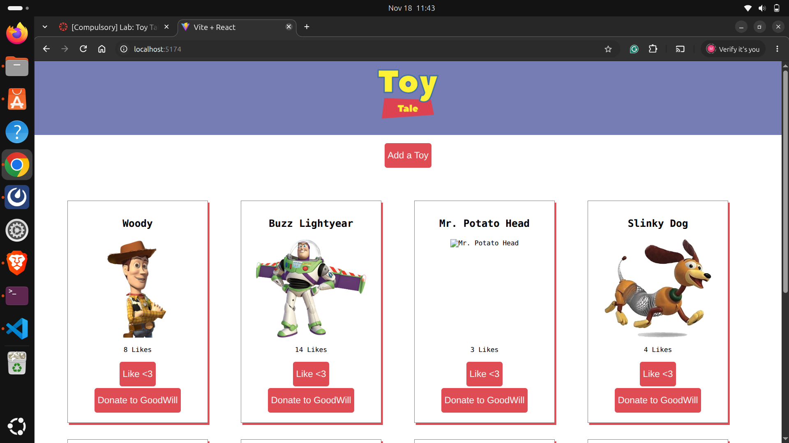

# Toy Tales

A React app for managing a collection of toys. Users can view all toys, add new ones, like their favorites, and donate toys they no longer want. Every change is saved to a local `json-server` backend.



## Features

- **View** all toys when the app loads (GET)
- **Add** a toy with a name and image URL (POST)
- **Like** a toy to increase its like count (PATCH)
- **Donate** a toy to remove it from the collection (DELETE)

## Installation

1. Fork and clone this repository.
2. Move into the project folder and install dependencies:
   ```bash
   cd react-hooks-toy-tales-vite
   npm install
   ```

## Usage

Run the backend and the React app in two separate terminals:

```bash
npm run server   # json-server at http://localhost:3001
npm run dev      # React app at http://localhost:5173
```

Then open the URL that `npm run dev` prints in your terminal.

## Running the Tests

```bash
npm test
```

## How It Works

Each feature follows the same pattern: an event happens, a fetch request is made, and state is updated.

| Feature | Event | Request | State update |
|---|---|---|---|
| Display toys | App loads | `GET /toys` | Set `toys` to the response |
| Add a toy | Form submit | `POST /toys` | Append the new toy |
| Like a toy | Click "Like" | `PATCH /toys/:id` | Replace the updated toy |
| Donate a toy | Click "Donate" | `DELETE /toys/:id` | Filter out the toy |

## Tech Stack

- React
- Vite
- json-server
- Vitest and React Testing Library


